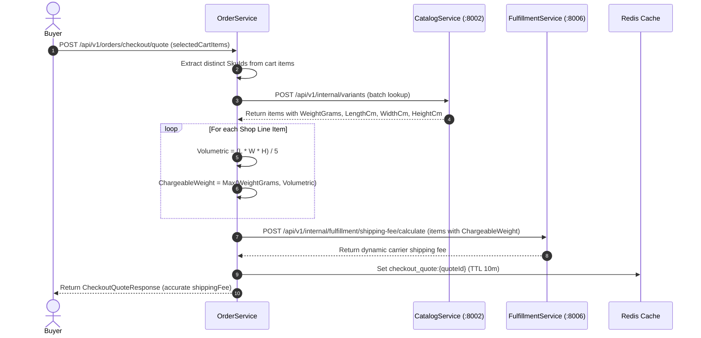
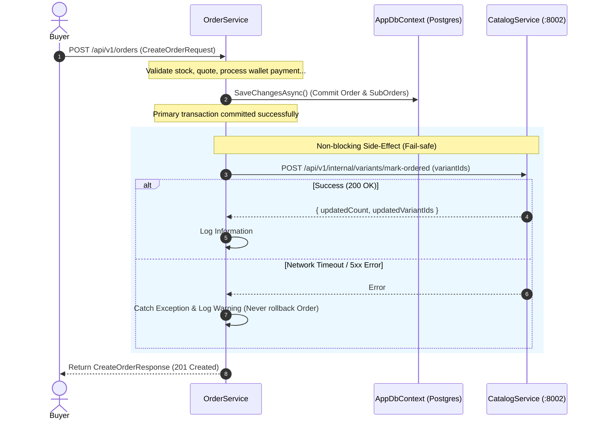

# Data Model & Interface Contracts: Catalog Ordered Flag & GHN Volumetric Dimensions

**Branch**: `034-catalog-ordered-flag-and-dimensions`  
**Date**: 2026-11-19  
**Spec**: [spec.md](spec.md)

---

## 1. Application Layer Contracts & DTOs

### 1.1. `CatalogProductCheckResult` (Updated)

Extended with packaging dimension fields defaulting to 0:

```csharp
namespace Commerce.Application.Interfaces;

public sealed record CatalogProductCheckResult(
    Guid SkuId,
    Guid ProductId,
    Guid SellerId,
    string ProductName,
    decimal UnitPrice,
    bool IsPurchasable,
    int StockQuantity = 100,
    string? ErrorReason = null,
    int WeightGrams = 0,
    string? SaleType = "Regular",
    int LengthCm = 0,
    int WidthCm = 0,
    int HeightCm = 0);
```

### 1.2. `CatalogVariantSwitchResult` (Updated)

Extended with packaging dimension fields defaulting to 0:

```csharp
namespace Commerce.Application.Interfaces;

public sealed record CatalogVariantSwitchResult(
    bool IsValid,
    Guid ProductId,
    Guid SellerId,
    Guid NewSkuId,
    string NewSkuName,
    decimal NewUnitPrice,
    bool IsPurchasable,
    int WeightGrams = 200,
    int LengthCm = 0,
    int WidthCm = 0,
    int HeightCm = 0);
```

### 1.3. `ICatalogClient` (Updated Interface)

Added `MarkVariantsOrderedAsync` definition:

```csharp
namespace Commerce.Application.Interfaces;

public interface ICatalogClient
{
    // Existing methods
    Task<CatalogProductCheckResult?> GetSkuDetailsAsync(Guid skuId, CancellationToken cancellationToken = default);
    Task<IReadOnlyDictionary<Guid, CatalogProductCheckResult>> GetSkuBatchDetailsAsync(IEnumerable<Guid> skuIds, CancellationToken cancellationToken = default);
    Task<CatalogVariantSwitchResult> ValidateVariantSwitchAsync(Guid currentSkuId, Guid newSkuId, CancellationToken cancellationToken = default);
    Task<bool> SyncPurchaseRecordAsync(CatalogPurchaseSyncRequest request, CancellationToken cancellationToken = default);
    Task<int> SyncPurchasesBatchAsync(Guid buyerId, Guid orderId, IEnumerable<Guid> productIds, DateTimeOffset? completedAt = null, CancellationToken cancellationToken = default);

    // New method for mark-ordered
    Task<bool> MarkVariantsOrderedAsync(IEnumerable<Guid> variantIds, CancellationToken cancellationToken = default);
}
```

---

## 2. Infrastructure Layer Models (`CatalogClient.cs`)

Internal models for serialization/deserialization:

```csharp
private sealed class CatalogMarkOrderedRequest
{
    public List<Guid> VariantIds { get; set; } = new();
}

private sealed class CatalogMarkOrderedResponse
{
    public int UpdatedCount { get; set; }
    public List<Guid>? UpdatedVariantIds { get; set; }
}

private sealed class CatalogVariantRawItem
{
    public Guid VariantId { get; set; }
    public Guid ProductId { get; set; }
    public Guid SellerId { get; set; }
    public string? ProductName { get; set; }
    public string? VariantName { get; set; }
    public string? SkuCode { get; set; }
    public decimal? Price { get; set; }
    public string? Currency { get; set; }
    public string? Status { get; set; }
    public string? ProductStatus { get; set; }
    public string? SaleType { get; set; }
    public string? PrimaryImageUrl { get; set; }
    public bool IsPurchasable { get; set; }
    public int? WeightGrams { get; set; }
    public int? LengthCm { get; set; }
    public int? WidthCm { get; set; }
    public int? HeightCm { get; set; }
}

private sealed class CatalogSwitchRawResponse
{
    public bool IsValid { get; set; }
    public Guid ProductId { get; set; }
    public Guid SellerId { get; set; }
    public Guid NewSkuId { get; set; }
    public string? NewSkuName { get; set; }
    public decimal NewUnitPrice { get; set; }
    public bool IsPurchasable { get; set; }
    public int WeightGrams { get; set; }
    public int LengthCm { get; set; }
    public int WidthCm { get; set; }
    public int HeightCm { get; set; }
}
```

---

## 3. Database Schema Impact

- **Schema Alterations**: **0 (None)**.
- **Entities**: Unchanged.
- **Persistence Lifecycle**: Dimension attributes are purely transient/in-flight; they are queried in real time from Catalog Service and transformed into `ChargeableWeight` for shipping fee quoting. Only the final computed monetary amount (`ShippingFeeAmount`) is persisted into `SubOrders`.

---

## 4. End-to-End Sequence Diagrams

### 4.1. Real-World GHN Shipping Fee Calculation (`QuoteCheckoutAsync`)



### 4.2. Synchronize Ordered Flag (`CreateOrderAsync`)


