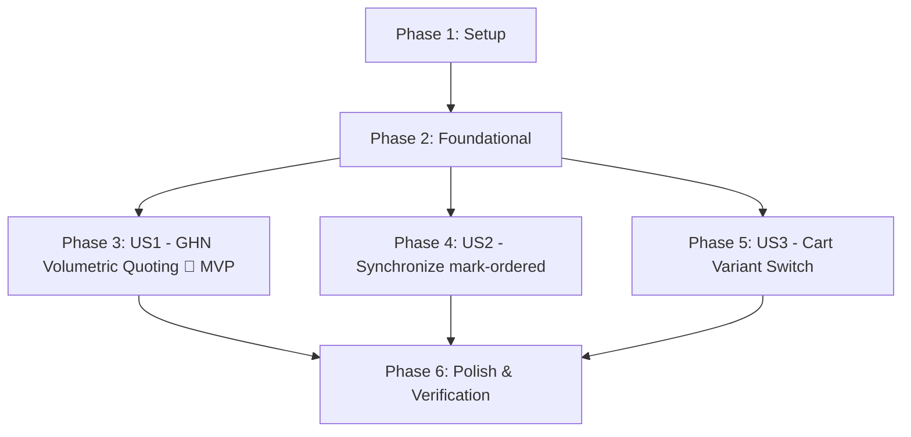

# Tasks: Catalog Ordered Flag & GHN Volumetric Dimensions

**Input**: Design documents from `/specs/034-catalog-ordered-flag-and-dimensions/`  
**Prerequisites**: [plan.md](plan.md), [spec.md](spec.md), [research.md](research.md), [data-model.md](data-model.md), [contracts/catalog-internal-api.yaml](contracts/catalog-internal-api.yaml), [quickstart.md](quickstart.md)

## Format: `[ID] [P?] [Story] Description`
- **[P]**: Can run in parallel (different files, no dependencies)
- **[Story]**: Which user story this task belongs to (e.g. US1, US2, US3)
- Exact file paths included in all task descriptions

---

## Phase 1: Setup (Shared Infrastructure)

**Purpose**: Verify repository status, branch, and ensure clean baseline build before changes

- [x] T001 Verify clean git working tree on branch `034-catalog-ordered-flag-and-dimensions`
- [x] T002 Verify solution build baseline with `dotnet build Commerce.sln -c Release -nodeReuse:false -m:1 --no-restore`

---

## Phase 2: Foundational (Blocking Prerequisites)

**Purpose**: Core contract definitions and client infrastructure required by all user stories

**⚠️ CRITICAL**: Must be completed before User Story implementation begins

- [x] T003 [P] Extend `CatalogProductCheckResult` with packaging dimensions `int LengthCm = 0, int WidthCm = 0, int HeightCm = 0` in [Commerce.Application/Interfaces/ICatalogClient.cs](file:///d:/CommerceService/Commerce.Application/Interfaces/ICatalogClient.cs)
- [x] T004 [P] Extend `CatalogVariantSwitchResult` with packaging dimensions `int LengthCm = 0, int WidthCm = 0, int HeightCm = 0` in [Commerce.Application/Interfaces/ICatalogClient.cs](file:///d:/CommerceService/Commerce.Application/Interfaces/ICatalogClient.cs)
- [x] T005 Add `MarkVariantsOrderedAsync(IEnumerable<Guid> variantIds, CancellationToken cancellationToken = default)` declaration to `ICatalogClient` in [Commerce.Application/Interfaces/ICatalogClient.cs](file:///d:/CommerceService/Commerce.Application/Interfaces/ICatalogClient.cs)
- [x] T006 [P] Update internal deserialization models `CatalogVariantRawItem` and `CatalogSwitchRawResponse` to parse `LengthCm`, `WidthCm`, `HeightCm` in [Commerce.Infrastructure/Services/Catalog/CatalogClient.cs](file:///d:/CommerceService/Commerce.Infrastructure/Services/Catalog/CatalogClient.cs)
- [x] T007 Implement `MarkVariantsOrderedAsync` targeting `POST api/v1/internal/variants/mark-ordered` with payload `{ variantIds }` and non-blocking error handling in [Commerce.Infrastructure/Services/Catalog/CatalogClient.cs](file:///d:/CommerceService/Commerce.Infrastructure/Services/Catalog/CatalogClient.cs)
- [x] T008 Update variant switch route to `api/v1/internal/variants/validate-switch` in [Commerce.Infrastructure/Services/Catalog/CatalogClient.cs](file:///d:/CommerceService/Commerce.Infrastructure/Services/Catalog/CatalogClient.cs)

**Checkpoint**: Foundation ready — all contract types and client methods in place for user story execution.

---

## Phase 3: User Story 1 - Real-World Carrier Shipping Fee Calculation during Checkout (Priority: P1) 🎯 MVP

**Goal**: Deliver accurate carrier shipping fee quotes during checkout (`QuoteCheckoutAsync`) using the standard GHN volumetric formula $(L \times W \times H) / 5$ (grams) and $\max(\text{actualWeight}, \text{volumetricWeight})$, eliminating the static 200g dummy fallback.

**Independent Test**: Invoke `QuoteCheckoutAsync` with items having packaging dimensions (e.g. $30 \times 25 \times 20\text{ cm}$, 300g) and verify the chargeable weight sent to Fulfillment Service is $3,000\text{g}$ per unit, not 200g.

### Tests for User Story 1

- [x] T009 [P] [US1] Add unit test in [tests/Commerce.UnitTests/Infrastructure/CatalogClientTests.cs](file:///d:/CommerceService/tests/Commerce.UnitTests/Infrastructure/CatalogClientTests.cs) verifying `GetSkuBatchDetailsAsync` parses `LengthCm`, `WidthCm`, `HeightCm`, and `WeightGrams` from Catalog JSON
- [x] T010 [P] [US1] Add unit tests in [tests/Commerce.UnitTests/ShippingQuoteContractTests.cs](file:///d:/CommerceService/tests/Commerce.UnitTests/ShippingQuoteContractTests.cs) verifying the GHN volumetric calculation formula:
  - Volumetric weight exceeds actual weight (e.g. $30 \times 25 \times 20\text{ cm}$, 300g $\rightarrow$ 3,000g)
  - Actual weight exceeds volumetric weight (e.g. $10 \times 10 \times 5\text{ cm}$, 1,500g $\rightarrow$ 1,500g)
  - Missing/zero dimensions fallback to actual weight or safe 200g minimum

### Implementation for User Story 1

- [x] T011 [US1] Implement static calculation helper `CalculateGhnChargeableWeight(int weightGrams, int lengthCm, int widthCm, int heightCm)` in [Commerce.Application/Services/Order/OrderService.cs](file:///d:/CommerceService/Commerce.Application/Services/Order/OrderService.cs)
- [x] T012 [US1] In `OrderService.QuoteCheckoutAsync`: collect all distinct SKU IDs from `selectedItems` and batch-fetch packaging dimensions via `_catalogClient.GetSkuBatchDetailsAsync(allSkuIds, ct)` in [Commerce.Application/Services/Order/OrderService.cs](file:///d:/CommerceService/Commerce.Application/Services/Order/OrderService.cs)
- [x] T013 [US1] In `OrderService.QuoteCheckoutAsync`: compute unit `chargeableWeight` for each line item using `CalculateGhnChargeableWeight` and pass into `new ShippingQuoteItem(i.SkuId, i.Quantity, chargeableWeight)` in [Commerce.Application/Services/Order/OrderService.cs](file:///d:/CommerceService/Commerce.Application/Services/Order/OrderService.cs)
- [x] T014 [US1] Add unit test in [tests/Commerce.UnitTests/Application/OrderServiceTests.cs](file:///d:/CommerceService/tests/Commerce.UnitTests/Application/OrderServiceTests.cs) verifying `QuoteCheckoutAsync` passes accurately computed chargeable weights to `IFulfillmentClient.CalculateShopShippingFeeAsync`

**Checkpoint**: User Story 1 is functional and verifiable independently. Shipping fee quotation calculates real carrier weights.

---

## Phase 4: User Story 2 - Lock Ordered SKU Deletion via `mark-ordered` Synchronization (Priority: P1)

**Goal**: Automatically synchronize `HasOrder = true` for all ordered variant IDs to Catalog Service upon successful order placement and auction settlement, protecting historical records while remaining resilient to network failures.

**Independent Test**: Place an order via `CreateOrderAsync` or settle an auction via `ReceiveSettlementAsync` and verify `ICatalogClient.MarkVariantsOrderedAsync` is invoked with deduplicated variant IDs.

### Tests for User Story 2

- [x] T015 [P] [US2] Add unit tests in [tests/Commerce.UnitTests/Infrastructure/CatalogClientTests.cs](file:///d:/CommerceService/tests/Commerce.UnitTests/Infrastructure/CatalogClientTests.cs) for `MarkVariantsOrderedAsync`:
  - 200 OK with `updatedCount > 0`
  - Empty variant list (early return true without HTTP call)
  - Catalog 500 error handling (logs warning and returns false gracefully)
  - Network timeout / exception handling (logs warning without crashing)
- [x] T016 [P] [US2] Add unit test in [tests/Commerce.UnitTests/Application/OrderServiceTests.cs](file:///d:/CommerceService/tests/Commerce.UnitTests/Application/OrderServiceTests.cs) verifying `CreateOrderAsync` calls `MarkVariantsOrderedAsync` with all distinct variant IDs after saving the order
- [x] T017 [P] [US2] Add unit test in [tests/Commerce.UnitTests/Application/AuctionOrderServiceTests.cs](file:///d:/CommerceService/tests/Commerce.UnitTests/Application/AuctionOrderServiceTests.cs) verifying `ReceiveSettlementAsync` calls `MarkVariantsOrderedAsync` when `SkuId` is present

### Implementation for User Story 2

- [x] T018 [US2] In `OrderService.CreateOrderAsync`: extract distinct `SkuId`s from `allQuoteItems`, invoke `_catalogClient.MarkVariantsOrderedAsync(allSkuIds, ct)` inside a non-blocking `try-catch` block with warning logging right after `_dbContext.SaveChangesAsync` in [Commerce.Application/Services/Order/OrderService.cs](file:///d:/CommerceService/Commerce.Application/Services/Order/OrderService.cs)
- [x] T019 [US2] In `AuctionOrderService.ReceiveSettlementAsync`: if `request.SkuId` is present and valid (`Guid.Empty`), invoke `_catalogClient.MarkVariantsOrderedAsync(new[] { request.SkuId.Value }, cancellationToken)` inside a non-blocking `try-catch` block after `_dbContext.SaveChangesAsync` in [Commerce.Application/Services/AuctionOrder/AuctionOrderService.cs](file:///d:/CommerceService/Commerce.Application/Services/AuctionOrder/AuctionOrderService.cs)
- [x] T020 [US2] Add test in [tests/Commerce.UnitTests/Application/OrderServiceTests.cs](file:///d:/CommerceService/tests/Commerce.UnitTests/Application/OrderServiceTests.cs) verifying that if `_catalogClient.MarkVariantsOrderedAsync` throws an exception, `CreateOrderAsync` still successfully returns `CreateOrderResponse` without rolling back

**Checkpoint**: User Story 2 is functional and verifiable independently. All placed orders synchronize ordered variants safely.

---

## Phase 5: User Story 3 - Up-to-Date Variant Dimensions during Cart Variant Switch (Priority: P2)

**Goal**: Validate variant switch against the standardized endpoint `api/v1/internal/variants/validate-switch` and ensure dimensions and weights are retrieved and parsed without error.

**Independent Test**: Call `ValidateVariantSwitchAsync` with valid IDs and verify the returned `CatalogVariantSwitchResult` contains `LengthCm`, `WidthCm`, `HeightCm`, and `WeightGrams`.

### Tests for User Story 3

- [x] T021 [P] [US3] Add unit test in [tests/Commerce.UnitTests/Infrastructure/CatalogClientTests.cs](file:///d:/CommerceService/tests/Commerce.UnitTests/Infrastructure/CatalogClientTests.cs) verifying `ValidateVariantSwitchAsync` sends request to `api/v1/internal/variants/validate-switch` and parses 3D dimensions correctly

### Implementation for User Story 3

- [x] T022 [US3] Verify and ensure `CartService.ChangeItemVariantAsync` in [Commerce.Application/Services/Cart/CartService.cs](file:///d:/CommerceService/Commerce.Application/Services/Cart/CartService.cs) consumes `ValidateVariantSwitchAsync` cleanly with the updated record signature

**Checkpoint**: User Story 3 complete. Variant switching route and dimension parsing validated.

---

## Phase 6: Polish & Cross-Cutting Concerns

**Purpose**: System-wide verification, code hygiene, and non-functional requirements

- [x] T023 Verify all log messages and exception messages follow 100% English Sentence-case and SCREAMING_SNAKE_CASE error codes
- [x] T024 Execute solution build: `dotnet build Commerce.sln -c Release -nodeReuse:false -m:1 --no-restore` (0 errors, 0 warnings)
- [x] T025 Run full unit test suite: `dotnet test tests/Commerce.UnitTests/Commerce.UnitTests.csproj -c Release` (100% pass)
- [x] T026 Execute end-to-end validation scenarios documented in [specs/034-catalog-ordered-flag-and-dimensions/quickstart.md](file:///d:/CommerceService/specs/034-catalog-ordered-flag-and-dimensions/quickstart.md)

---

## Dependencies & Execution Order

### Phase Dependencies

### Parallel Opportunities

- **Within Phase 2**: Tasks `T003`, `T004`, `T006` can run in parallel.
- **Between User Stories**: Once Phase 2 completes, Phase 3 (US1), Phase 4 (US2), and Phase 5 (US3) can proceed in parallel.
- **Within Tests**: `T009`, `T010`, `T015`, `T016`, `T017`, `T021` can be implemented and run in parallel.

---

## Implementation Strategy

### MVP First (User Story 1)
1. Complete Phase 1 (Setup) and Phase 2 (Foundational contracts).
2. Complete Phase 3 (User Story 1): Deliver accurate carrier shipping fee calculation.
3. Validate User Story 1 independently with unit tests.

### Incremental Delivery
1. Add Phase 4 (User Story 2): Deliver `mark-ordered` synchronization on order and auction creation.
2. Add Phase 5 (User Story 3): Standardize variant switch route and dimension parsing.
3. Complete Phase 6: Run full verification checklist, compile release build, and confirm 100% test pass.
