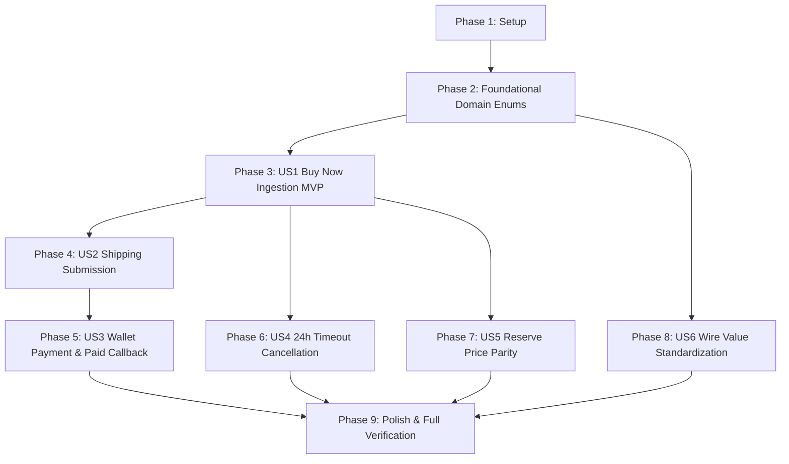

# Tasks: Auction Buy Now & Reserve Price Settlement Integration

**Input**: Design documents from `specs/035-auction-buy-now-and-reserve-settlement/`  
**Prerequisites**: `plan.md`, `spec.md`, `research.md`, `data-model.md`, `contracts/auction-buy-now-api.yaml`, `quickstart.md`  

---

## Phase 1: Setup (Baseline Verification)

**Purpose**: Verify the build and test suite baseline before modifying source files.

- [X] T001 Baseline build and test suite verification in `Commerce.sln`

---

## Phase 2: Foundational (Blocking Prerequisites)

**Purpose**: Core Domain models and contract extensions required across all user stories.

**⚠️ CRITICAL**: Must complete before any user story tasks can begin.

- [X] T002 [P] Add `BuyNow = 3` to `AuctionOrderSource` enum in `Commerce.Domain/Enums/AuctionOrderSource.cs`
- [X] T003 [P] Add `BuyNow => "BUY_NOW"` mapping to `ToWireValue` extension method in `Commerce.Domain/Enums/AuctionOrderSourceExtensions.cs`
- [X] T004 [P] Update enum wire contract unit tests in `tests/Commerce.UnitTests/AuctionOrderSourceContractTests.cs` to assert `BuyNow.ToWireValue() == "BUY_NOW"`

**Checkpoint**: Domain Foundation ready - user story implementation can begin.

---

## Phase 3: User Story 1 - Buy Now Settlement Ingestion with 100% Held Deposit (Priority: P1) 🎯 MVP

**Goal**: Accept settlement with `source = "BUY_NOW"`, recognize 100% held deposit (`depositAmount == winningAmount`), calculate `RemainingAmount = 0 VND`, initialize order in `PendingPayment`, and return HTTP 201 Created.

**Independent Test**: Call `POST /api/v1/auction-orders/settlement` with `source: "BUY_NOW"` and `depositAmount == winningAmount`. Assert `AuctionOrder` record is created with `OrderSource = BuyNow`, `RemainingAmount = 0`, `Status = PendingPayment`, and response contains `orderSource: "BUY_NOW"`.

### Tests for User Story 1
- [X] T005 [P] [US1] Add Buy Now settlement unit tests in `tests/Commerce.UnitTests/AuctionOrderServiceTests.cs` (verifying 100% deposit deduction, `RemainingAmount = 0`, 5% platform fee, 95% seller payout, and idempotency)

### Implementation for User Story 1
- [X] T006 [US1] Update `ReceiveSettlementAsync` in `Commerce.Application/Services/AuctionOrder/AuctionOrderService.cs` to allow `"BUY_NOW"` alongside `"WINNER"` and `"SECOND_CHANCE"`, mapping `"BUY_NOW"` to `AuctionOrderSource.BuyNow`
- [X] T007 [US1] Validate `RemainingAmount = Math.Max(0m, WinningAmount - DepositAmount)` evaluates to `0 VND` and `AuctionSettlementResponse` returns `orderSource = "BUY_NOW"` in `Commerce.Application/Services/AuctionOrder/AuctionOrderService.cs`

**Checkpoint**: User Story 1 fully functional and testable independently.

---

## Phase 4: User Story 2 - Winner Shipping Destination Submission & Carrier Fee Allocation (Priority: P1)

**Goal**: Allow buyer of a Buy Now order to submit delivery address, calculate carrier shipping fee from GHN, and update `TotalAmount = RemainingAmount (0) + ShippingFeeAmount = ShippingFeeAmount`.

**Independent Test**: Call `PUT /api/v1/auction-orders/{id}/shipping` for a Buy Now order (`RemainingAmount = 0`). Assert `ShippingFeeAmount` is set to GHN fee and `TotalAmount` equals `ShippingFeeAmount`.

### Tests for User Story 2
- [X] T008 [P] [US2] Add shipping fee calculation unit tests for Buy Now orders in `tests/Commerce.UnitTests/AuctionOrderServiceTests.cs` asserting `TotalAmount == ShippingFeeAmount`

### Implementation for User Story 2
- [X] T009 [US2] Verify `UpdateShippingAsync` in `Commerce.Application/Services/AuctionOrder/AuctionOrderService.cs` ensures `TotalAmount = RemainingAmount + ShippingFeeAmount` correctly calculates the exact shipping fee for Buy Now orders

**Checkpoint**: User Story 2 fully functional and testable independently.

---

## Phase 5: User Story 3 - Net Shipping Wallet Payment & Outbound Paid Callback Dispatch (Priority: P1)

**Goal**: Debit only `TotalAmount` (shipping fee) from buyer's Nexus Wallet, transition order to `Paid`, and dispatch outbound callback `Paid` with `orderSource: "BUY_NOW"` and `occurredAt` to Auction Service.

**Independent Test**: Call `POST /api/v1/auction-orders/{id}/pay` for a Buy Now order. Assert `IWalletClient.PayOrderAsync` debits `TotalAmount`, order status becomes `Paid`, and outbound callback has `orderSource: "BUY_NOW"`.

### Tests for User Story 3
- [X] T010 [P] [US3] Add wallet payment and outbound callback unit tests for Buy Now orders in `tests/Commerce.UnitTests/AuctionOrderServiceTests.cs`

### Implementation for User Story 3
- [X] T011 [US3] Verify `PayAuctionOrderAsync` in `Commerce.Application/Services/AuctionOrder/AuctionOrderService.cs` debits only `TotalAmount` and dispatches `Paid` callback with `orderSource: "BUY_NOW"` and `occurredAt`

**Checkpoint**: User Story 3 fully functional and testable independently.

---

## Phase 6: User Story 4 - 24-Hour Payment Timeout Cancellation & Dispute-Free Notification (Priority: P1)

**Goal**: Automatically cancel Buy Now orders exceeding 24 hours without shipping payment, dispatch `PaymentTimedOut` callback with `orderSource: "BUY_NOW"` and `occurredAt`, and avoid calling `UserService` to penalize the buyer.

**Independent Test**: Execute `PaymentTimeoutWorker` sweep against an expired Buy Now order. Assert status becomes `Cancelled`, outbound callback has `orderSource: "BUY_NOW"`, and 0 penalty calls are made to `IUserClient`.

### Tests for User Story 4
- [X] T012 [P] [US4] Add 24h payment timeout cancellation unit tests for Buy Now orders in `tests/Commerce.UnitTests/AuctionOrderServiceTests.cs` (or `tests/Commerce.UnitTests/PaymentTimeoutWorkerTests.cs`)

### Implementation for User Story 4
- [X] T013 [US4] Verify timeout cancellation logic in `Commerce.Api/Workers/PaymentTimeoutWorker.cs` dispatches `PaymentTimedOut` with `orderSource = expiredOrder.OrderSource.ToWireValue()` and skips buyer penalty calls

**Checkpoint**: User Story 4 fully functional and testable independently.

---

## Phase 7: User Story 5 - Architectural Reserve Price Settlement Ingestion Parity (Priority: P2)

**Goal**: Guarantee that auction settlements resulting from seller reserve price approvals process 100% through the standard `source = "WINNER"` pipeline without requiring custom flags.

**Independent Test**: Execute unit test for `source: "WINNER"` on an order with reserve price characteristics and assert identical processing to standard winning bids.

### Tests for User Story 5
- [X] T014 [P] [US5] Add unit test confirming standard WINNER flow processing for reserve price authorized settlements in `tests/Commerce.UnitTests/AuctionOrderServiceTests.cs`

**Checkpoint**: User Story 5 verified.

---

## Phase 8: User Story 6 - Strict Outbound Callback Wire Value Standardization (Priority: P2)

**Goal**: Standardize all outbound callback serialization points across `AuctionOrderService` and `PaymentTimeoutWorker` to call `.ToWireValue()`, preventing `"BUYNOW"` or `"SECONDCHANCE"` string formatting bugs.

**Independent Test**: Inspect and unit test callback serialization to confirm `"BUY_NOW"`, `"SECOND_CHANCE"`, and `"WINNER"` are dispatched across all event types.

### Implementation for User Story 6
- [X] T015 [P] [US6] Standardize `SellerAcceptAsync` and `SellerRejectAsync` callback serialization to use `auctionOrder.OrderSource.ToWireValue()` in `Commerce.Application/Services/AuctionOrder/AuctionOrderService.cs`
- [X] T016 [P] [US6] Standardize seller expired callback serialization to use `expiredOrder.OrderSource.ToWireValue()` in `Commerce.Api/Workers/PaymentTimeoutWorker.cs`
- [X] T017 [P] [US6] Add unit tests in `tests/Commerce.UnitTests/AuctionOrderSourceContractTests.cs` asserting strict snake_case wire format serialization across all `AuctionOrderSource` values

**Checkpoint**: User Story 6 verified.

---

## Phase 9: Polish & Cross-Cutting Concerns

**Purpose**: Documentation updates, full build, and test verification.

- [X] T018 [P] Update API contract documentation and integration notes in `docs/COMMERCE_API_CONTRACT.md`
- [X] T019 Execute full solution build `dotnet build Commerce.sln -c Release` and assert 0 errors
- [X] T020 Execute full test suite `dotnet test Commerce.sln -c Release` and assert 100% pass rate
- [X] T021 Run quickstart end-to-end simulation verification per `specs/035-auction-buy-now-and-reserve-settlement/quickstart.md`

---

## Dependencies & Execution Order

### Phase Dependencies
- **Setup (Phase 1)**: Can run immediately.
- **Foundational (Phase 2)**: Depends on Setup; BLOCKS all User Story phases.
- **User Story 1 (Phase 3)**: Depends on Foundational completion (MVP candidate).
- **User Story 2 (Phase 4)**: Depends on US1 completion.
- **User Story 3 (Phase 5)**: Depends on US2 completion.
- **User Story 4 (Phase 6)**: Depends on US1 completion (can run in parallel with US2/US3).
- **User Story 5 (Phase 7)**: Depends on US1 completion.
- **User Story 6 (Phase 8)**: Depends on Foundational completion (can run in parallel with US1-US5).
- **Polish (Phase 9)**: Depends on all preceding phases.

---

## Implementation Strategy

### MVP First (User Story 1 Only)
1. Complete Phase 1 (Baseline Verification).
2. Complete Phase 2 (Foundational Domain Enums & Wire Mapping).
3. Complete Phase 3 (User Story 1: Settlement Ingestion with 100% Held Deposit).
4. **VALIDATE MVP**: Verify settlement returns HTTP 201 with `orderSource: "BUY_NOW"` and `RemainingAmount = 0 VND`.

### Incremental Delivery
- Increment 1: Foundational + US1 (Inbound Settlement Ingestion).
- Increment 2: US2 + US3 (Shipping Fee Calculation & Wallet Payment).
- Increment 3: US4 (Payment Timeout Sweep without Buyer Penalties).
- Increment 4: US5 + US6 (Reserve Price Parity & Callback Standardization).
- Increment 5: Polish & Full Regression Tests.
